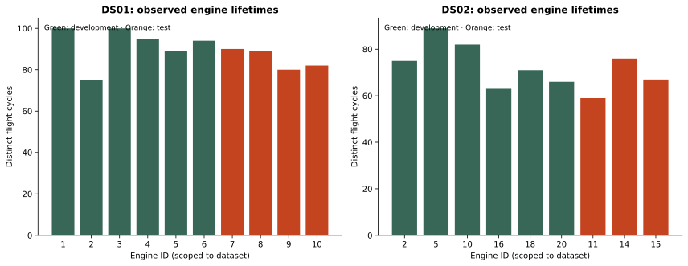
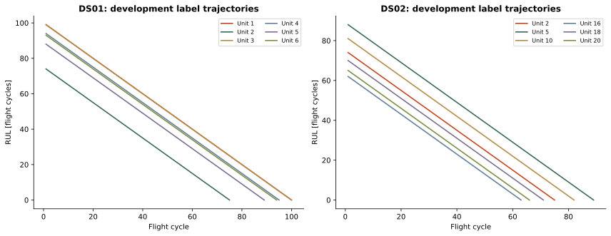
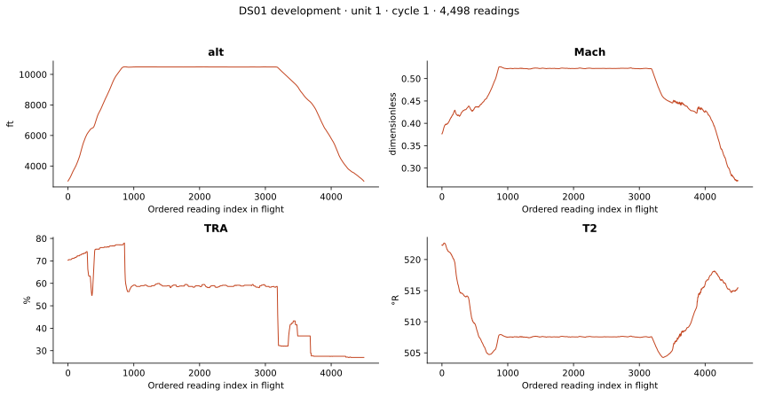
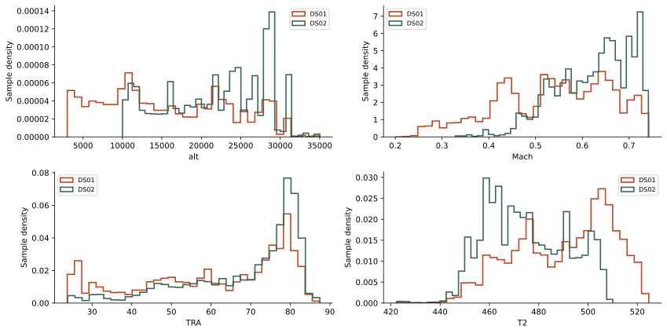
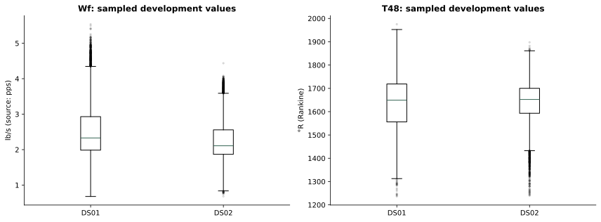
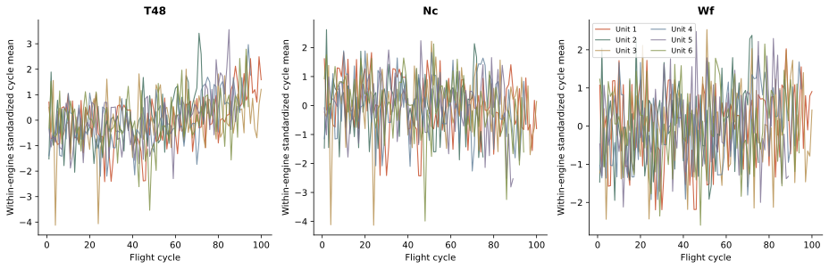
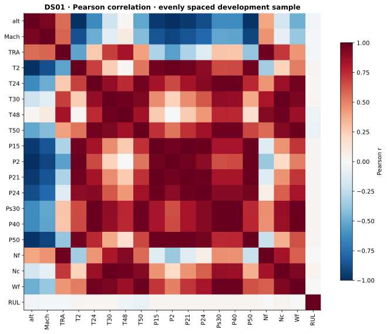

# Task 3 — Data Understanding Report

**GR05 · Industrial Analytics · WS 2026/27**<br>
**Team:** Selçuk Ata Aksoy and Denzel Gregory Pragassa<br>
**Analysis date:** 2026-10-22<br>
**Status:** Executed descriptive analysis; team interpretation/review pending. No predictive model trained.

## 1. Purpose and course alignment

We need to explain the dataset before preparing features or training models. The supplied task sheet `tasks/IBS6 Industrial Analytics Project Tasks V3.0.pdf`, p. 1, requests dataset structure/features, types/distributions, missing values/anomalies, and an Exploratory Analysis Notebook with a feature description table, visualizations, summary statistics, and a data quality report. Its internal heading says V12.0; this report cites the supplied filename and 22 October 2026 date rather than assuming those version labels agree.

This work is CRISP-DM data understanding. It answers what the data contains and what limitations matter for later RUL regression. The lecturer's verbal emphasis was understanding the data; model training and extensive cleaning are intentionally deferred.

| Required element | Evidence |
|---|---|
| Structure and features | Notebook sections 2–3; `inventory.csv`; `feature_dictionary.csv` |
| Data types and distributions | Full-array statistics; operating/sensor distribution figures |
| Missing values and anomalies | Full numeric scan; sample IQR screen; six-dimension quality table |
| Exploratory notebook | [Executed guided notebook](../notebooks/01-data-understanding.ipynb) |
| Visualizations and interpretation | Seven exported figures; notebook explanations and discussion below |
| Summary statistics and quality report | Sections 5–6 below; machine-readable evidence in `reports/results/` |

## 2. Sources and provenance

The two actual local HDF5 files are `N-CMAPSS_DS01-005.h5` and `N-CMAPSS_DS02-006.h5`, supplied under `data/raw/` after a Kaggle download. Exact file identity:

| File | Bytes | Local SHA-256 |
| --- | --- | --- |
| N-CMAPSS_DS01-005.h5 | 2,873,351,432 | 3abdcee2a3c8136e8880e5d43ac8cdf12ab9f7f3ab37145f23b24c11335afbed |
| N-CMAPSS_DS02-006.h5 | 2,450,472,504 | 47971a68b239ecb756833218a95d68ded6eb7e63ee84e86671c8b188de1ca765 |

Combined size is 4.958 GiB. Checksums identify local bytes; no upstream checksum comparison or Kaggle version/license verification has been completed.

The two accompanying files under `data/` are source references, not additional measurement datasets:

- `Run_to_Failure_Simulation_Under_Real_Flight_Conditions_Dataset.pdf`: seven-page preprint, 20 April 2020, focused on the DS02 nine-unit scenario. Tables 1–4 describe physical variables; pp. 3–5 discuss trajectories, flight classes, and a 1 Hz sampling rate for that scenario.
- `N-CMAPSS_Example_data_loading_and_exploration.ipynb`: example credited to Manuel Arias. Used to understand loading and metadata; its full-array concatenation pattern was replaced by read-only chunks. Its long-flight class prose contains a typo; we follow its class table and actual codes.

These are distinct from the 2021 journal article for the wider N-CMAPSS collection ([Arias Chao et al., Data 6(1), 5](https://doi.org/10.3390/data6010005)). The local older paper omits `P2` from its measured-sensor table and lists some virtual variables absent from these files. Our inventory follows actual HDF5 metadata; the `P2` interpretation/unit remains flagged for source confirmation.

## 3. Observational structure and population

| Subset | Partition | Readings | Engines | Flights | Lifetime range (cycles) |
| --- | --- | --- | --- | --- | --- |
| DS01 | dev | 4,906,636 | 6 | 553 | 75–100 |
| DS01 | test | 2,735,232 | 4 | 341 | 80–90 |
| DS02 | dev | 5,263,447 | 6 | 446 | 63–89 |
| DS02 | test | 1,253,743 | 3 | 202 | 59–76 |

Together the files contain **14,159,058 readings**, **1,542 engine-flight pairs**, and **19 dataset-scoped engine histories**. This does not establish 19 independent physical engines across subsets. Some IDs and lifetimes recur; cross-subset independence/identity is unresolved. Analyse splits within a subset and retain dataset identity.

One row is an aligned operating/sensor reading. Many readings belong to the same flight. A flight is identified by dataset + unit + cycle. A reading can be located by dataset + partition + row index; there is no explicit timestamp. There are six aligned numeric blocks, totalling **47 stored fields**: W (4), X_s (14), X_v (14), T (10), Y (1), A (4). W + X_s give **18 candidate physical predictors** for the first baseline; the other 29 fields have different roles.

The provided development/test engine IDs are disjoint within both files. DS01 uses development units 1–6 and test units 7–10. DS02 uses development units 2, 5, 10, 16, 18, 20 and test units 11, 14, 15. These are complete labelled run-to-failure histories in the local files, not the truncated test sequences one might expect from the original C-MAPSS benchmark.

| Subset | Split | Unit | Flight class | Readings | Flights | RUL range |
| --- | --- | --- | --- | --- | --- | --- |
| DS01 | dev | 1 | 1 | 433,325 | 100 | 0–99 |
| DS01 | dev | 2 | 3 | 1,049,088 | 75 | 0–74 |
| DS01 | dev | 3 | 2 | 893,054 | 100 | 0–99 |
| DS01 | dev | 4 | 1 | 414,172 | 95 | 0–94 |
| DS01 | dev | 5 | 3 | 1,280,147 | 89 | 0–88 |
| DS01 | dev | 6 | 2 | 836,850 | 94 | 0–93 |
| DS01 | test | 7 | 1 | 392,585 | 90 | 0–89 |
| DS01 | test | 8 | 2 | 800,294 | 89 | 0–88 |
| DS01 | test | 9 | 1 | 351,683 | 80 | 0–79 |
| DS01 | test | 10 | 3 | 1,190,670 | 82 | 0–81 |
| DS02 | dev | 2 | 3 | 853,142 | 75 | 0–74 |
| DS02 | dev | 5 | 3 | 1,033,420 | 89 | 0–88 |
| DS02 | dev | 10 | 3 | 952,711 | 82 | 0–81 |
| DS02 | dev | 16 | 3 | 765,295 | 63 | 0–62 |
| DS02 | dev | 18 | 3 | 890,719 | 71 | 0–70 |
| DS02 | dev | 20 | 3 | 768,160 | 66 | 0–65 |
| DS02 | test | 11 | 3 | 663,495 | 59 | 0–58 |
| DS02 | test | 14 | 1 | 156,778 | 76 | 0–75 |
| DS02 | test | 15 | 2 | 433,470 | 67 | 0–66 |



## 4. Feature descriptions, scales, and physical meaning

LPC/HPC mean low/high-pressure compressor; HPT/LPT mean low/high-pressure turbine. Rankine (°R) is an absolute temperature scale, psia is absolute pressure, and rpm is revolutions/minute. The lecturer's *Dataset Scales* PPTX, slides 3–4, guides the table below: nominal labels allow equality; ordinal categories add ordering; interval variables support meaningful differences; ratio variables have meaningful zero points. Discrete/continuous variation is recorded separately from measurement scale. RUL is a discrete ratio count; Rankine temperature is continuous ratio. Altitude has a reference datum and is treated as interval; cycle is an interval index, while an aggregated flight count is ratio. The classifications for throttle control position and simulator modifiers are explicit working interpretations; P2 and stall-margin zero conventions remain unconfirmed.

The supplied *Task 3 - Describe Data - Feature Description Table - Data Types.ipynb* guides our pandas inspection and `feature_description_table.csv` (188 file/partition/feature rows). It includes storage dtype, full non-null counts/ranges, sampled uniqueness, scale, valid operators, null flags, and notes. Domain-specific overrides replace generic guesses based on numeric dtype or high uniqueness; a mostly unique sensor value is not an ID. Notebook copies demonstrate int64 IDs/counts and ordered/unordered categorical types without modifying raw files.

Float64 storage does not make engine IDs continuous measurements. Flight class is ordinal (1 short, 2 medium, 3 long); health state is a categorical retrospective label. Both are metadata, not first-baseline predictors.

| Block | Variable | Storage | Meaning | Unit | Attribute type | Variation | Scale | Operators | Role |
| --- | --- | --- | --- | --- | --- | --- | --- | --- | --- |
| W | alt | float64 | Altitude | ft | quantitative (metric) | continuous | Interval | ==, !=, <, <=, >, >=, +, - | candidate predictor |
| W | Mach | float64 | Flight Mach number | dimensionless | quantitative (metric) | continuous | Ratio | ==, !=, <, <=, >, >=, +, -, *, / | candidate predictor |
| W | TRA | float64 | Throttle-resolver angle | % | quantitative (metric) | continuous | Interval | ==, !=, <, <=, >, >=, +, - | candidate predictor |
| W | T2 | float64 | Total temperature at fan inlet | °R (Rankine) | quantitative (metric) | continuous | Ratio | ==, !=, <, <=, >, >=, +, -, *, / | candidate predictor |
| X_s | T24 | float64 | Total temperature at LPC outlet | °R (Rankine) | quantitative (metric) | continuous | Ratio | ==, !=, <, <=, >, >=, +, -, *, / | candidate predictor |
| X_s | T30 | float64 | Total temperature at HPC outlet | °R (Rankine) | quantitative (metric) | continuous | Ratio | ==, !=, <, <=, >, >=, +, -, *, / | candidate predictor |
| X_s | T48 | float64 | Total temperature at HPT outlet | °R (Rankine) | quantitative (metric) | continuous | Ratio | ==, !=, <, <=, >, >=, +, -, *, / | candidate predictor |
| X_s | T50 | float64 | Total temperature at LPT outlet | °R (Rankine) | quantitative (metric) | continuous | Ratio | ==, !=, <, <=, >, >=, +, -, *, / | candidate predictor |
| X_s | P15 | float64 | Total pressure in bypass duct | psia | quantitative (metric) | continuous | Ratio | ==, !=, <, <=, >, >=, +, -, *, / | candidate predictor |
| X_s | P2 | float64 | Inlet pressure; interpretation/unit require source confirmation | not confirmed | quantitative (metric) | continuous | Unconfirmed | Confirm semantics first | candidate predictor |
| X_s | P21 | float64 | Total pressure at fan outlet | psia | quantitative (metric) | continuous | Ratio | ==, !=, <, <=, >, >=, +, -, *, / | candidate predictor |
| X_s | P24 | float64 | Total pressure at LPC outlet | psia | quantitative (metric) | continuous | Ratio | ==, !=, <, <=, >, >=, +, -, *, / | candidate predictor |
| X_s | Ps30 | float64 | Static pressure at HPC outlet | psia | quantitative (metric) | continuous | Ratio | ==, !=, <, <=, >, >=, +, -, *, / | candidate predictor |
| X_s | P40 | float64 | Total pressure at burner outlet | psia | quantitative (metric) | continuous | Ratio | ==, !=, <, <=, >, >=, +, -, *, / | candidate predictor |
| X_s | P50 | float64 | Total pressure at LPT outlet | psia | quantitative (metric) | continuous | Ratio | ==, !=, <, <=, >, >=, +, -, *, / | candidate predictor |
| X_s | Nf | float64 | Physical fan speed | rpm | quantitative (metric) | continuous | Ratio | ==, !=, <, <=, >, >=, +, -, *, / | candidate predictor |
| X_s | Nc | float64 | Physical core speed | rpm | quantitative (metric) | continuous | Ratio | ==, !=, <, <=, >, >=, +, -, *, / | candidate predictor |
| X_s | Wf | float64 | Fuel flow | lb/s (source: pps) | quantitative (metric) | continuous | Ratio | ==, !=, <, <=, >, >=, +, -, *, / | candidate predictor |
| X_v | T40 | float64 | Total temperature at burner outlet | °R (Rankine) | quantitative (metric) | continuous | Ratio | ==, !=, <, <=, >, >=, +, -, *, / | simulator-only; exclude from baseline |
| X_v | P30 | float64 | Total pressure at HPC outlet | psia | quantitative (metric) | continuous | Ratio | ==, !=, <, <=, >, >=, +, -, *, / | simulator-only; exclude from baseline |
| X_v | P45 | float64 | Total pressure at HPT outlet | psia | quantitative (metric) | continuous | Ratio | ==, !=, <, <=, >, >=, +, -, *, / | simulator-only; exclude from baseline |
| X_v | W21 | float64 | Fan flow | lb/s (source: pps) | quantitative (metric) | continuous | Ratio | ==, !=, <, <=, >, >=, +, -, *, / | simulator-only; exclude from baseline |
| X_v | W22 | float64 | Flow out of LPC | lbm/s | quantitative (metric) | continuous | Ratio | ==, !=, <, <=, >, >=, +, -, *, / | simulator-only; exclude from baseline |
| X_v | W25 | float64 | Flow into HPC | lbm/s | quantitative (metric) | continuous | Ratio | ==, !=, <, <=, >, >=, +, -, *, / | simulator-only; exclude from baseline |
| X_v | W31 | float64 | HPT coolant bleed | lbm/s | quantitative (metric) | continuous | Ratio | ==, !=, <, <=, >, >=, +, -, *, / | simulator-only; exclude from baseline |
| X_v | W32 | float64 | HPT coolant bleed | lbm/s | quantitative (metric) | continuous | Ratio | ==, !=, <, <=, >, >=, +, -, *, / | simulator-only; exclude from baseline |
| X_v | W48 | float64 | Flow out of HPT | lbm/s | quantitative (metric) | continuous | Ratio | ==, !=, <, <=, >, >=, +, -, *, / | simulator-only; exclude from baseline |
| X_v | W50 | float64 | Flow out of LPT | lbm/s | quantitative (metric) | continuous | Ratio | ==, !=, <, <=, >, >=, +, -, *, / | simulator-only; exclude from baseline |
| X_v | SmFan | float64 | Fan stall margin | dimensionless | quantitative (metric) | continuous | Unconfirmed | Confirm semantics first | simulator-only; exclude from baseline |
| X_v | SmLPC | float64 | LPC stall margin | dimensionless | quantitative (metric) | continuous | Unconfirmed | Confirm semantics first | simulator-only; exclude from baseline |
| X_v | SmHPC | float64 | HPC stall margin | dimensionless | quantitative (metric) | continuous | Unconfirmed | Confirm semantics first | simulator-only; exclude from baseline |
| X_v | phi | float64 | Ratio of fuel flow to Ps30 | pps/psi | quantitative (metric) | continuous | Ratio | ==, !=, <, <=, >, >=, +, -, *, / | simulator-only; exclude from baseline |
| T | fan_eff_mod | float64 | fan efficiency modifier (simulator health parameter) | modifier | quantitative (metric) | continuous | Interval | ==, !=, <, <=, >, >=, +, - | simulator-only; exclude from baseline |
| T | fan_flow_mod | float64 | fan flow modifier (simulator health parameter) | modifier | quantitative (metric) | continuous | Interval | ==, !=, <, <=, >, >=, +, - | simulator-only; exclude from baseline |
| T | LPC_eff_mod | float64 | LPC efficiency modifier (simulator health parameter) | modifier | quantitative (metric) | continuous | Interval | ==, !=, <, <=, >, >=, +, - | simulator-only; exclude from baseline |
| T | LPC_flow_mod | float64 | LPC flow modifier (simulator health parameter) | modifier | quantitative (metric) | continuous | Interval | ==, !=, <, <=, >, >=, +, - | simulator-only; exclude from baseline |
| T | HPC_eff_mod | float64 | HPC efficiency modifier (simulator health parameter) | modifier | quantitative (metric) | continuous | Interval | ==, !=, <, <=, >, >=, +, - | simulator-only; exclude from baseline |
| T | HPC_flow_mod | float64 | HPC flow modifier (simulator health parameter) | modifier | quantitative (metric) | continuous | Interval | ==, !=, <, <=, >, >=, +, - | simulator-only; exclude from baseline |
| T | HPT_eff_mod | float64 | HPT efficiency modifier (simulator health parameter) | modifier | quantitative (metric) | continuous | Interval | ==, !=, <, <=, >, >=, +, - | simulator-only; exclude from baseline |
| T | HPT_flow_mod | float64 | HPT flow modifier (simulator health parameter) | modifier | quantitative (metric) | continuous | Interval | ==, !=, <, <=, >, >=, +, - | simulator-only; exclude from baseline |
| T | LPT_eff_mod | float64 | LPT efficiency modifier (simulator health parameter) | modifier | quantitative (metric) | continuous | Interval | ==, !=, <, <=, >, >=, +, - | simulator-only; exclude from baseline |
| T | LPT_flow_mod | float64 | LPT flow modifier (simulator health parameter) | modifier | quantitative (metric) | continuous | Interval | ==, !=, <, <=, >, >=, +, - | simulator-only; exclude from baseline |
| Y | RUL | int64 | Remaining useful life until simulated end-of-life | flight cycles | quantitative (metric) | discrete | Ratio | ==, !=, <, <=, >, >=, +, -, *, / | target; never a predictor |
| A | unit | float64 | Engine identifier; unique only within a dataset | identifier | qualitative (categorical) | categorical | Nominal | ==, != | grouping/diagnostic metadata; exclude from baseline |
| A | cycle | float64 | Flight-cycle index within an engine history | flight cycle | quantitative (metric) | discrete | Interval | ==, !=, <, <=, >, >=, +, - | grouping/diagnostic metadata; exclude from baseline |
| A | Fc | float64 | Flight class: 1 short, 2 medium, 3 long | class code | qualitative (categorical) | ordered categorical | Ordinal | ==, !=, <, <=, >, >= | grouping/diagnostic metadata; exclude from baseline |
| A | hs | float64 | Health state: 1 healthy, 0 degraded (example notebook interpretation) | binary code | qualitative (categorical) | categorical | Nominal | ==, != | grouping/diagnostic metadata; exclude from baseline |

`X_v` virtual channels and `T` health modifiers expose simulator information that may not be available in practice. Use them only for explanation unless availability is justified. The simulator's “measured sensors” are simulated responses, not observed real-world engine failures.

## 5. Descriptive findings and interpretation

### 5.1 RUL labels are a retrospective countdown

Every engine-flight checked satisfies **RUL = final observed cycle − current cycle**, constant inside each flight, ending at zero. The scan found 0 combined flags across within-flight label consistency, countdown logic, cycle continuity, health-state direction, and mixed class/health checks. DS01 lifetimes range from 75 to 100 cycles; DS02 from 59 to 89. These label trajectories explain the target; they are not a model result. The final cycle uses future information and must never be used as a predictor.



### 5.2 Flight operating conditions affect sensor readings

A flight contains varying altitude, Mach, throttle, and inlet temperature. Sensor changes can reflect mission phase and engine condition together. The single-flight figure uses the first DS01 development flight and an ordered reading index. The paper's 1 Hz statement does not supply missing timestamps or prove gap-free time sampling in our copies.



### 5.3 Operating-regime coverage differs across splits

**All six DS02 development engines are flight class 3; test also contains class 1 (unit 14) and class 2 (unit 15).** DS01 has all three classes in both splits. This is structural evidence of a generalization challenge, not evidence of model failure. Longer flights yield more readings, so raw-row averages weight them more heavily. Report per-engine results later instead of relying only on a row-weighted score. Test structure/labels were inspected in this EDA; document that exposure and do not adaptively tune to the test data.



### 5.4 Full-data statistics, sampled distributions

The following statistics cover complete **development** arrays. Min/max, mean and sample standard deviation are full-scan results, not sample estimates. The full 188-row statistics export includes all 47 fields in all four file partitions.

| Subset | Variable | Minimum | Mean | Std | Maximum |
| --- | --- | --- | --- | --- | --- |
| DS01 | alt | 3001.000 | 15683.712 | 8007.308 | 35033.000 |
| DS01 | Mach | 0.000 | 0.538 | 0.119 | 0.749 |
| DS01 | TRA | 23.555 | 60.596 | 18.404 | 88.769 |
| DS01 | T2 | 421.378 | 490.204 | 19.606 | 534.383 |
| DS01 | T48 | 955.057 | 1640.812 | 123.803 | 1986.323 |
| DS01 | Nc | 7370.761 | 8237.886 | 226.255 | 8866.007 |
| DS01 | Wf | 0.336 | 2.540 | 0.781 | 5.590 |
| DS01 | RUL | 0.000 | 44.836 | 26.639 | 99.000 |
| DS02 | alt | 10001.000 | 21901.030 | 6288.498 | 35033.000 |
| DS02 | Mach | 0.258 | 0.624 | 0.079 | 0.749 |
| DS02 | TRA | 23.555 | 68.547 | 14.549 | 87.626 |
| DS02 | T2 | 421.378 | 475.009 | 16.586 | 510.815 |
| DS02 | T48 | 944.501 | 1642.638 | 98.535 | 1912.816 |
| DS02 | Nc | 7366.108 | 8204.632 | 184.067 | 8745.187 |
| DS02 | Wf | 0.328 | 2.250 | 0.566 | 4.539 |
| DS02 | RUL | 0.000 | 37.327 | 22.373 | 88.000 |



Cycle means average all readings from a given flight. Sensor trend plots standardize these means within each complete development engine for visual comparison only. That transformation uses future history and is not suitable unchanged as a deployable preprocessing step. Whole-flight averages mix operating regimes and do not isolate causal wear.



The Pearson heatmap covers 18 candidate predictors plus RUL on the DS01 development sample. Operating regimes, engine differences, and temporal dependence can create correlations; neither predictive performance nor causality follows from them. No independent-observation significance tests are claimed.



## 6. Data quality — lecturer's six dimensions

| Dimension | Coverage | Observed result | Limit |
| --- | --- | --- | --- |
| Conformity | Full metadata + all auxiliary codes | Arrays aligned; invalid category codes: 0; invalid IDs/cycles: 0 | P2 definition/unit requires source confirmation; file metadata does not prove physical units. |
| Completeness | Every numeric cell in both files | NaN: 0; infinity: 0 | Sentinel values and gaps in physical time are not established by NaN checks. |
| Uniqueness | All adjacent rows + 12,000 evenly spaced rows per partition | Adjacent exact duplicates: 0; sampled exact duplicates: 0 | All non-adjacent duplicates were not exhaustively checked; repeated flight keys are valid. |
| Accuracy | Full ranges + development-sample IQR screens | 49 dataset-variable pairs have sampled IQR flags; no rows removed | Extreme values are not proven errors; no independent physical ground truth. |
| Timeliness | Provided sources and metadata | Static simulation data; no calendar timestamp column | Download version/terms remain to be recorded; current operational relevance is unvalidated. |
| Consistency | All engine-flight aggregates + full auxiliary scan | Engine overlap: {'DS01': [], 'DS02': []}; cycle/label/health checks flagged: 0 | Both partitions were inspected for understanding; keep test data out of later tuning. |

The complete scan covers **665,475,726 numeric cells**. No NaN or infinite values were detected. No invalid auxiliary codes/indices or within-unit backward cycle transitions were found. These results do not establish physical accuracy, absence of sentinel values, or absence of missing time intervals.

Exact duplicate checks cover all **adjacent full records** and the deterministic sample of 12,000 rows per partition (48,000 rows in total). Both found zero duplicates. All possible non-adjacent pairs in 14 million readings were not exhaustively compared. Repeated engine/cycle/label values are expected; automatically deduplicating on those fields would destroy valid within-flight trajectories.

The IQR screen uses development-only samples, independently within each subset. Its most flagged dataset-variable pairs are:

| Subset | Variable | Sample rows | Flagged | Flagged % |
| --- | --- | --- | --- | --- |
| DS02 | Nf | 12000 | 603 | 5.03 |
| DS01 | SmFan | 12000 | 592 | 4.93 |
| DS02 | phi | 12000 | 540 | 4.50 |
| DS02 | SmHPC | 12000 | 502 | 4.18 |
| DS01 | Wf | 12000 | 460 | 3.83 |
| DS02 | T40 | 12000 | 449 | 3.74 |
| DS02 | Wf | 12000 | 438 | 3.65 |
| DS02 | T48 | 12000 | 417 | 3.48 |

IQR flags are candidates for investigation, not confirmed errors. Mixed operating regimes can create long tails. No raw values were removed, imputed, clipped, resampled, or normalized for training in Task 3.

## 7. Feasible next decisions

1. Begin preparation with DS01 and candidate W + X_s variables; keep DS02 as a later robustness case. This is a proposed scope, pending team agreement.
2. Consider end-of-flight predictions with current-flight features; define the prediction point before aggregation and modeling.
3. Keep unit-grouped development validation and preserve provided test engines. Fit preprocessing on training engines only; document this notebook's test exposure.
4. Exclude RUL, final engine lifetime, future cycles, health state, and hidden simulator quantities from baseline predictors. IDs are grouping keys, not numeric predictors.
5. Confirm upstream file/version and redistribution terms, and resolve P2's source definition/unit. Investigate possible shared engine histories before combining subsets.
6. Only after preparation, establish a simple baseline and measure MAE/RMSE in flight cycles, including per-engine errors and optimistic RUL overestimation.

No trained-model performance, economic savings, real-engine failure validation, or aviation suitability is claimed.

## 8. Reproduce and explain

```bash
python3 -m venv .venv
source .venv/bin/activate
python -m pip install -r requirements.txt
python -m jupyterlab
# Run notebooks/01-data-understanding.ipynb top to bottom.
python scripts/build_task3_report.py
```

The notebook discovers the repository from its working directory, validates expected file paths, uses 100,000-row chunks, and exports CSV/JSON evidence and seven SVG figures. Distribution/IQR/duplicate samples are deterministic evenly spaced row indices, 12,000 per partition. They are not random population samples. Raw HDF5 arrays remain local and ignored by Git.

Environment used: python 3.12.3, numpy 2.5.4, pandas 3.0.6, h5py 3.16.0, matplotlib 3.11.2, jupyterlab 4.6.4, nbclient 0.11.0, nbformat 5.11.1. Complete installed dependency versions are recorded in `requirements-lock.txt`; primary packages are pinned in `requirements.txt`.

Use the notebook's presentation questions to practise explaining rows vs flights vs engines, label construction, storage vs scale, outliers vs errors, split shift, and leakage. Both team members should review the report and be able to reproduce its explanations.

## 9. References and disclosure

- Supplied project task sheet, p. 1: `IBS6 Industrial Analytics Project Tasks V3.0.pdf`, dated 22 October 2026; internal heading V12.0.
- Supplied *Industrial Analytics — Introduction V2.0*, pp. 10–11: descriptive, diagnostic, predictive, prescriptive categories.
- Supplied *Data Science — Introduction V1.0*, pp. 9–12: systematic process, context, overfitting.
- Supplied *IBS6 Industrial Analytics - Dataset Scales.pptx*, slides 3–4, and *Task 3 - Describe Data - Feature Description Table - Data Types.ipynb*: measurement scales, operations, dtype inspection and feature-table layout.
- Lecturer's “Verify Data Quality” screenshot supplied in the conversation: conformity, completeness, uniqueness, accuracy, timeliness, consistency. No page number asserted for this separate excerpt.
- Supplied Arias Chao et al. preprint, 20 April 2020, Tables 1–4, pp. 3–5; accompanying example notebook credited to Manuel Arias.
- Arias Chao et al. (2021), [Data 6(1), 5](https://doi.org/10.3390/data6010005); [Kaggle redistribution](https://www.kaggle.com/datasets/bishals098/nasa-cmapss-2-engine-degradation).
- AI drafting/coding assistance and pending human review: [AI use log](ai-use-log.md).

This report and `findings.html` are generated by `scripts/build_task3_report.py` from notebook exports. Edit reusable narrative there if regenerating; keep measured values tied to the exported evidence.
