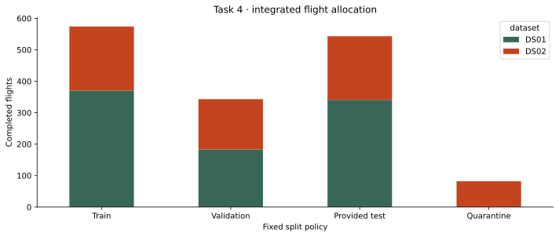
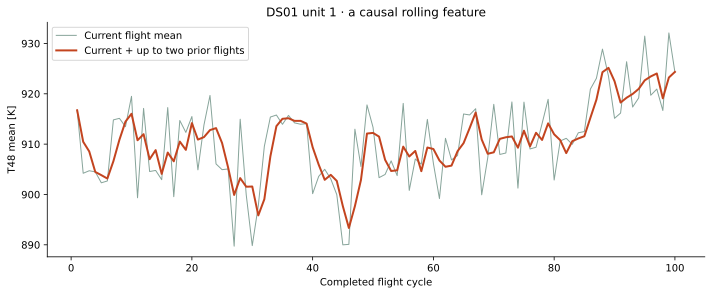
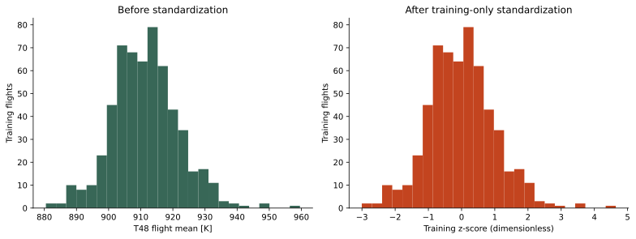

# Task 4 — Data Preparation and Feature Engineering

**GR05 · Industrial Analytics · HFU · WS 2026/27**<br>
**Team:** Selçuk Ata Aksoy and Denzel Gregory Pragassa<br>
**Prepared version:** `task4-v1-97719f3fe055`<br>
**Run:** 2026-10-29T10:46:06.486884+01:00<br>
**Status:** Pipeline executed, modeling inputs exported; team interpretation review pending. No RUL prediction model trained.

## 1. What this task means

Task 3 examined what is in our files. Task 4 turns those observations into a repeatable, well-defined input for a future model. A model cannot automatically know which columns are labels, which values use different units, or which engine histories must stay separate. Those are preparation decisions we must explain.

The supplied `tasks/IBS6 Industrial Analytics Project Tasks V4.0.pdf`, p. 2, dated 26 October 2026 (internal heading V12.0), asks for cleaning, transformation/normalization, feature engineering, integration and versioned data. All requested deliverables are provided:

| Deliverable | Actual artifact |
|---|---|
| Cleaned dataset ready for modeling | `data/processed/task4-v1-97719f3fe055/flights_features.csv`; finite `X_*.csv`, separate `y_*.csv` and matching `rows_*.csv` |
| Preprocessing pipeline | `src/preprocessing.py`, `config/preprocessing.json`, CLI `scripts/prepare_data.py`; saved fitted `preprocessor.joblib` in the local version |
| Feature engineering documentation | This report, executed `notebooks/02-preprocessing.ipynb`, full `feature_catalog.csv` |
| Versioned raw/processed comparison | Raw SHA-256 identity, code/config/environment fingerprint, immutable local prepared version, artifact checksums, compact comparison/audit evidence |

## 2. Understand the data without machine-learning terminology

Think of each engine as a diary. A **reading** is a detailed snapshot during a flight. A **flight** groups many snapshots. A **history** groups that engine's flights in order. The historical **RUL** is the number of remaining flight cycles until simulated end-of-life.

Our original files contain **14,159,058 readings**, arranged in **19 dataset-scoped histories**. They are not 14 million independent engines. The simulation uses real flight operating profiles; degradation and sensor responses are simulated, not measured actual engine failures. Independence between subsets is unresolved.

For this version we make a prediction **at the end of a completed flight**. Everything in that flight and previous observed flights is available; tomorrow's measurements and the known final failure cycle are not. Therefore the prepared dataset has **1,542 flight rows**. This is the prediction contract, not just a convenient reduction in file size.

| Kind of entry | Examples | Meaning and relevance |
|---|---|---|
| Operating conditions (W) | altitude, Mach, throttle, inlet temperature | Describe the flight situation; sensor values can change because conditions changed |
| Sensor channels (X_s) | temperatures, pressures, fuel flow, fan/core speed | Describe engine response; combine them with operating context |
| Target (Y) | RUL | Historical answer for training/evaluation, kept separately as y |
| Metadata (A) | unit, cycle, flight class | Identify/order/group histories and describe coverage; not predictors here |
| Source collection | DS01 / DS02 | Categorical context for the combined table, encoded as two source indicators |
| Simulator-only information | virtual X_v, health modifiers T, health state hs | Excluded from baseline inputs; not assumed available from physical sensors |
| Unresolved measured channel | P2 | Excluded pending source definition/unit confirmation |

`X` means the inputs a future model may see; `y` means the answer. Unit 10 is a label, not twice unit 5. RUL is a count in flight cycles. Temperatures are absolute Rankine in the source, not Celsius. The distinction between stored numeric dtype and measurement meaning follows the lecturer's scale guide from Task 3.

### An actual prepared entry

The preview export contains DS01 unit 1, flight 1, with 4,498 readings, mean altitude 2669.31 m and mean T48 916.72 K. Its historical RUL is 99 cycles. Its previous-flight difference is missing because this is the first observed flight. Filling that missing predictor does not mean changing the historical RUL.

## 3. Cleaning and consistency decisions

| Subset | Partition | Readings | Non-finite predictor cells | Impossible predictor cells | Readings removed |
| --- | --- | --- | --- | --- | --- |
| DS01 | dev | 4906636 | 0 | 0 | 0 |
| DS01 | test | 2735232 | 0 | 0 | 0 |
| DS02 | dev | 5263447 | 0 | 0 | 0 |
| DS02 | test | 1253743 | 0 | 0 | 0 |

The run found **0 non-finite selected predictor cells**, **0 unambiguously impossible selected predictor cells**, and removed **0 raw readings**. We report zeros because that is the observed result. This is not a proof of physical accuracy or absence of every possible sentinel.

The pipeline supports NaN/infinity handling by converting invalid predictor values to missing before aggregation. Non-positive absolute temperatures, pressures and shaft speeds, and negative Mach/fuel flow are treated as impossible under this scoped representation. Finite unusual values are retained; IQR flags are not deletion rules. Altitude is not required to be positive as a universal physical rule because its reference datum matters.

Keys, flight class and targets must be valid: positive integer engine/cycle IDs, class in 1/2/3, nonnegative integer RUL, aligned arrays. Bad keys or labels stop the run; they are not median-imputed or reconstructed. Within-flight target/class conflicts, backward/noncontiguous cycles and inconsistent retrospective RUL labels also stop the run. Duplicate aggregate keys are prohibited; repeated raw unit/cycle pairs are expected because a flight has many readings. Global exact raw-row deduplication is not performed.

After aggregation and causal feature engineering there are **57 missing feature cells**, all in previous-flight differences at the beginning of histories. Training has 21, validation 12, test 21, quarantine 3. First-flight gaps are expected, rather than newly discovered broken sensors.

## 4. Physical transformations and aggregation

Seventeen channels are retained: W's four operating conditions plus thirteen X_s channels. P2 is excluded. Units are converted before computing flight statistics:

| Conversion | Formula |
|---|---|
| ft → m | × 0.3048 |
| absolute °R → K | × 5/9 |
| psia → kPa | × 6.894757293168 |
| lb/s → kg/s | × 0.45359237 |
| Mach, throttle %, rpm | retained |

Each flight's mean and sample standard deviation (ddof 1) use all finite selected readings. Within-chunk moments are combined with stable weighted moment formulas across chunk boundaries. The count `n_readings` counts original observations, not finite cells, and is not claimed to be verified seconds. Unit conversions are fixed mathematical transformations; they do not learn from validation/test data.

Whole-flight summaries mix climb/cruise/descent. They are a manageable initial representation, not a demonstrated isolation of causal degradation. Future phase-based features require a separate justified preparation version.

## 5. Dataset integration and conservative split policy

The prepared flight tables are appended under a common schema with explicit source identity. A source history uses `dataset:unit` (e.g. DS01:2); the split grouping additionally links equal raw unit IDs across subsets conservatively. Equal IDs do not prove identical physical engines, but ignoring the uncertainty could let related histories cross splits.

**Critical conflict:** DS01 unit 10 is supplied test; DS02 unit 10 is supplied development. Its **82 DS02 development flights are retained in quarantine**, and used in neither training nor validation nor test scoring. Original test rows retain their supplied designation.

Validation IDs **5, 6, 18** are fixed in configuration before any performance experiment. Other eligible development histories become training. This yields:

| Subset | Original partition | Prepared split | Flights | Histories | Original readings |
| --- | --- | --- | --- | --- | --- |
| DS01 | dev | train | 370 | 4 | 2789639 |
| DS01 | dev | validation | 183 | 2 | 2116997 |
| DS01 | test | test | 341 | 4 | 2735232 |
| DS02 | dev | quarantine_test_related | 82 | 1 | 952711 |
| DS02 | dev | train | 204 | 3 | 2386597 |
| DS02 | dev | validation | 160 | 2 | 1924139 |
| DS02 | test | test | 202 | 3 | 1253743 |

Training spans 7 source histories but only 6 conservative unit-ID groups; validation spans 4 source histories and 3 conservative groups. Test has 7 source histories/groups. These are not a proof of total independence; unrecognized cross-ID dependence remains possible. The preprocessor fits only on the **574 training flights**. This version integrates both subsets; the simpler DS01-only scope remains available by selecting the DS01 histories under the same grouping policy and refitting preprocessing.



Task 3 inspected test structure/labels. That exposure is documented and must not become adaptive tuning. The arbitrary fixed validation choice is a starting protocol, not a statistically optimal holdout. Later grouped cross-validation must fit imputer/scaler/encoder again inside each training fold.

## 6. Feature engineering catalog

There are **45 numeric candidates**: 17 means + 17 within-flight standard deviations + 1 reading count + 3 trailing means + 3 previous-flight differences + 4 physical combinations. Source identity is the only categorical input. The baseline selection uses just 17 means + reading count + 2 source indicators = **20 columns**.

Trailing means use current and up to two previous flight means, separately within a source history; no centered windows or backward filling. Differences use current minus immediately previous flight. The first difference is undefined. Pressure/speed ratios are **ratios of flight means**, not averages of instantaneous ratios. They are diagnostics, not calibrated health or efficiency estimates.

| Feature | Family | Source | Unit | Definition |
| --- | --- | --- | --- | --- |
| alt_m_mean | current_flight | alt | m | Mean of finite readings in the current completed flight |
| alt_m_std | current_flight | alt | m | Sample standard deviation of finite readings in the current flight (ddof=1) |
| Mach_mean | current_flight | Mach | dimensionless | Mean of finite readings in the current completed flight |
| Mach_std | current_flight | Mach | dimensionless | Sample standard deviation of finite readings in the current flight (ddof=1) |
| TRA_pct_mean | current_flight | TRA | % | Mean of finite readings in the current completed flight |
| TRA_pct_std | current_flight | TRA | % | Sample standard deviation of finite readings in the current flight (ddof=1) |
| T2_K_mean | current_flight | T2 | K | Mean of finite readings in the current completed flight |
| T2_K_std | current_flight | T2 | K | Sample standard deviation of finite readings in the current flight (ddof=1) |
| T24_K_mean | current_flight | T24 | K | Mean of finite readings in the current completed flight |
| T24_K_std | current_flight | T24 | K | Sample standard deviation of finite readings in the current flight (ddof=1) |
| T30_K_mean | current_flight | T30 | K | Mean of finite readings in the current completed flight |
| T30_K_std | current_flight | T30 | K | Sample standard deviation of finite readings in the current flight (ddof=1) |
| T48_K_mean | current_flight | T48 | K | Mean of finite readings in the current completed flight |
| T48_K_std | current_flight | T48 | K | Sample standard deviation of finite readings in the current flight (ddof=1) |
| T50_K_mean | current_flight | T50 | K | Mean of finite readings in the current completed flight |
| T50_K_std | current_flight | T50 | K | Sample standard deviation of finite readings in the current flight (ddof=1) |
| P15_kPa_mean | current_flight | P15 | kPa | Mean of finite readings in the current completed flight |
| P15_kPa_std | current_flight | P15 | kPa | Sample standard deviation of finite readings in the current flight (ddof=1) |
| P21_kPa_mean | current_flight | P21 | kPa | Mean of finite readings in the current completed flight |
| P21_kPa_std | current_flight | P21 | kPa | Sample standard deviation of finite readings in the current flight (ddof=1) |
| P24_kPa_mean | current_flight | P24 | kPa | Mean of finite readings in the current completed flight |
| P24_kPa_std | current_flight | P24 | kPa | Sample standard deviation of finite readings in the current flight (ddof=1) |
| Ps30_kPa_mean | current_flight | Ps30 | kPa | Mean of finite readings in the current completed flight |
| Ps30_kPa_std | current_flight | Ps30 | kPa | Sample standard deviation of finite readings in the current flight (ddof=1) |
| P40_kPa_mean | current_flight | P40 | kPa | Mean of finite readings in the current completed flight |
| P40_kPa_std | current_flight | P40 | kPa | Sample standard deviation of finite readings in the current flight (ddof=1) |
| P50_kPa_mean | current_flight | P50 | kPa | Mean of finite readings in the current completed flight |
| P50_kPa_std | current_flight | P50 | kPa | Sample standard deviation of finite readings in the current flight (ddof=1) |
| Nf_rpm_mean | current_flight | Nf | rpm | Mean of finite readings in the current completed flight |
| Nf_rpm_std | current_flight | Nf | rpm | Sample standard deviation of finite readings in the current flight (ddof=1) |
| Nc_rpm_mean | current_flight | Nc | rpm | Mean of finite readings in the current completed flight |
| Nc_rpm_std | current_flight | Nc | rpm | Sample standard deviation of finite readings in the current flight (ddof=1) |
| Wf_kg_s_mean | current_flight | Wf | kg/s | Mean of finite readings in the current completed flight |
| Wf_kg_s_std | current_flight | Wf | kg/s | Sample standard deviation of finite readings in the current flight (ddof=1) |
| n_readings | current_flight | row count | readings | Number of ordered readings in current flight; proxy for observed flight length, not verified seconds |
| T48_K_trailing3 | causal_history | T48_K | K | Mean of current and up to 2 previous flight means, within the same history |
| T48_K_delta_prev | causal_history | T48_K | K | Current flight mean minus previous flight mean; missing on first observed flight |
| Nc_rpm_trailing3 | causal_history | Nc_rpm | rpm | Mean of current and up to 2 previous flight means, within the same history |
| Nc_rpm_delta_prev | causal_history | Nc_rpm | rpm | Current flight mean minus previous flight mean; missing on first observed flight |
| Wf_kg_s_trailing3 | causal_history | Wf_kg_s | kg/s | Mean of current and up to 2 previous flight means, within the same history |
| Wf_kg_s_delta_prev | causal_history | Wf_kg_s | kg/s | Current flight mean minus previous flight mean; missing on first observed flight |
| lpc_pressure_ratio | physical_combination | current flight means | dimensionless | P24 mean / P21 mean, both total pressures |
| burner_to_lpt_pressure_ratio | physical_combination | current flight means | dimensionless | P40 mean / P50 mean; diagnostic ratio, not calibrated efficiency |
| hpt_to_lpt_temperature_drop_K | physical_combination | current flight means | K difference | T48 mean minus T50 mean; diagnostic temperature difference |
| core_to_fan_speed_ratio | physical_combination | current flight means | dimensionless | Nc mean / Nf mean; diagnostic shaft speed ratio |



No target, engine ID, cycle index, final lifetime, healthy/degraded flag, flight-class code, virtual sensor or health modifier enters the feature matrix. Dataset source is allowed only as categorical context, not a claim of degradation. All statistics are available by the end of the current flight.

## 7. Fitted preprocessing: missing values, encoding, scaling

The saved scikit-learn `ColumnTransformer` contains:

1. Numeric `SimpleImputer(strategy='median', add_indicator=True, keep_empty_features=True)` fitted on training flights only.
2. `StandardScaler` fitted to those imputed numeric features and their missingness indicators (training standard deviation with ddof 0; zero-variance scale becomes 1).
3. `OneHotEncoder` for the declared DS01/DS02 source categories; source columns stay unscaled 0/1. Unexpected source categories raise an error.

The actual missing-value features and learned medians are:

| Feature | Training median | Missing training | Missing all histories |
| --- | --- | --- | --- |
| T48_K_delta_prev | 0.3626173918629547 | 7 | 19 |
| Nc_rpm_delta_prev | -0.06645288826439355 | 7 | 19 |
| Wf_kg_s_delta_prev | 0.0006251387363767069 | 7 | 19 |

The numeric 45 inputs gain three missingness indicators, then two source indicators: **50 model columns** in total. Numeric missingness indicators are standardized along with numeric features, so their matrix values are no longer literal 0/1. The full readable feature table preserves physical units and missing cells; the finite X matrices are the imputed/scaled representation.

All active X matrices are finite and use the same column order. `y_*.csv` retains unchanged RUL in flight cycles. `rows_*.csv` provides matching identity and grouping fields in exactly the same order.

Maximum absolute fitted numeric training column mean after standardization: **2.6e-14** (floating-point tolerance). Validation/test do not have to be centered or within a fixed range. Scaling is not operating-regime correction and does not prove better RUL performance.



Official references: [scikit-learn common pitfalls](https://scikit-learn.org/stable/common_pitfalls.html), [SimpleImputer](https://scikit-learn.org/stable/modules/generated/sklearn.impute.SimpleImputer.html), [StandardScaler](https://scikit-learn.org/stable/modules/generated/sklearn.preprocessing.StandardScaler.html), [OneHotEncoder](https://scikit-learn.org/stable/modules/generated/sklearn.preprocessing.OneHotEncoder.html).

## 8. Raw vs prepared comparison and versioning

| Stage | Row meaning | Rows | Representation |
| --- | --- | --- | --- |
| Raw | One ordered reading | 14159058 | 47 stored fields; six aligned blocks |
| Prepared | One completed flight | 1542 | 45 physical/history features + metadata + RUL |
| Train | One completed flight | 574 | 50 finite model inputs; target separate |
| Validation | One completed flight | 343 | 50 finite model inputs; target separate |
| Test | One completed flight | 543 | 50 finite model inputs; target separate |
| Quarantine | One completed flight | 82 | Retained; no fitting, validation, or test scoring |

Raw file identity is retained, without rewriting/copying the raw dataset into Git:

| Raw file | Bytes | SHA-256 |
| --- | --- | --- |
| N-CMAPSS_DS01-005.h5 | 2,873,351,432 | 3abdcee2a3c8136e8880e5d43ac8cdf12ab9f7f3ab37145f23b24c11335afbed |
| N-CMAPSS_DS02-006.h5 | 2,450,472,504 | 47971a68b239ecb756833218a95d68ded6eb7e63ee84e86671c8b188de1ca765 |

Prepared data is stored locally at **`data/processed/task4-v1-97719f3fe055/`**. The version fingerprint combines raw file hashes, configuration, preprocessing/helper code hashes, Python and relevant package versions. Every output artifact has a recorded checksum; matching versions are verified/reused. Changed code, policy, data or dependency versions produce a new directory. Existing output files are not silently overwritten.

`manifest.json` describes this version; it lists artifact hashes but is not self-hashed. It is an integrity record for local reproducibility, not a cryptographic signature or upstream provenance certificate.

| Local artifact | Bytes | SHA-256 |
| --- | --- | --- |
| X_test.csv | 398,517 | 099897dbbf09d4d20da0854c2fef3516d83d084060fd277d7e8c89139a686759 |
| X_train.csv | 420,749 | e7cf3a0b7753293103f9f5bbd4bbdcdf3c35990a760c31166f574b0c043161b7 |
| X_validation.csv | 253,706 | eb7d048b9dd1ea65b02ac884b2360edea5dc2b9ecfc0412193d797bad79835c0 |
| baseline_columns.json | 522 | 6e5499153fee805a98a32951a7b72956b26e970a3d926815419cc233d320e045 |
| cleaning_audit.csv | 224 | 6fbca6cdc2e22860248061980538783210d64ddc3c1a38dfe146a85319d02e96 |
| engine_splits.csv | 767 | fd1883d7ae7a23b01833b4e84ff6d5a7146c1c4acc7741222d1d95da083f3f6e |
| feature_catalog.csv | 6,744 | 63c5c215993328710b0aa5771b72b2e004fe20acdcd88a0a8fd1d3899c206f3f |
| flights_features.csv | 1,026,901 | 3b6b444e86864647dd5e266489b5913909ce68ed7e8b3ebe57dfa373ba73aa6e |
| imputation_parameters.csv | 1,662 | b9a032fc206c490ca47721d6595cad233cc3ec188d5618669ef1f09b3729777b |
| preprocessor.joblib | 6,766 | a97536d737bfdc5586659f1e31225c7a32d466a6582e1ab5e0e746dd9eae4a24 |
| quarantine.csv | 56,807 | 0820915e227d7734c0ba07111590251490a30e798314a3085a542c10a5acd55f |
| rows_test.csv | 20,421 | 712809bbb9a603e60d6c914696ba2504dc53656d74600723c45c47de65811b87 |
| rows_train.csv | 21,074 | 4acee638da2418407f35ce9c6000fcf0c5dd69ffb1b1f15d0e79d2648dc8c23c |
| rows_validation.csv | 14,324 | 2a3e7ec9f12376b8beab55745cbba71d2ceb4d66f0da169a404e3fe4769474aa |
| scaling_parameters.csv | 2,991 | 1cf578164f81c1a0f6ed11d4f9e4c70a90131068c0dee6c186ffeab42f39eb97 |
| split_summary.csv | 291 | 8afce9770a7ad88e83b875ea1fe54e3aee634868323bcc224474075c311bb405 |
| y_test.csv | 1,563 | 4833c4d3ad005059798bfaf3e83fb92023a7cd8dfcec955ac3a86202c20ab06a |
| y_train.csv | 1,656 | 4f03dabe602db9fc5a0da75a3669a27b454e8479f9df5277842ba328db573bf4 |
| y_validation.csv | 993 | 894c4d32d117d519b3d515a3461c032bafa26ffd635d14ea926a50d122afae43 |

`flights_features.csv` includes all rows and original labels, including quarantine; no separate X/y quarantine matrices are made because those rows are not intended for scoring. `preprocessor.joblib` is a fitted transformation, not an RUL predictor. `baseline_columns.json` defines the smaller input selection. Raw and processed files remain ignored by Git; compact manifests, summaries, feature definitions and figures under `reports/` can be reviewed/versioned in Git.

## 9. Reproduce and use the results

```bash
source .venv/bin/activate
python -m pip install -r requirements.txt
python scripts/prepare_data.py
python -m jupyterlab
# Run notebooks/02-preprocessing.ipynb top to bottom for explanations and figures.
python scripts/build_task4_report.py
python -m unittest discover -s tests -v
```

The CLI builds or verifies the prepared version and exports compact evidence. The notebook executes the same pipeline, explains the decisions, verifies matrices, demonstrates that held-out transformations do not refit training parameters, and saves three preparation figures. The report/page generator reads those actual exports. Use the version manifest rather than guessing a directory name.

For the first modeling experiment, load `X_train.csv` and `y_train.csv`, choose `baseline_columns.json`, and use the corresponding validation files. Keep `rows_*.csv` for per-engine metrics. If changing validation groups or using cross-validation, refit preprocessing accordingly. Final test should follow model selection; do not treat repeated row samples as independent engines.

Targeted tests cover chunk-boundary aggregation and unit conversions, non-finite handling, causal/history isolation, cross-subset test quarantine, training-only medians/scaling, and unknown-category rejection. The original Task 3 tests also remain available. No RUL model is fitted and no MAE/RMSE is asserted.

## 10. Limitations and next decisions

- A small number of conservative engine groups limits confidence; the 50-column candidate set is not validated and a 20-column baseline is provided.
- Unit-based conservative linking addresses one known risk, but cross-subset independence remains unresolved; it can also over-group unrelated engines.
- Whole-flight summaries mix phases, lose detailed transient ordering and can retain operating-regime effects. Reading count may encode flight-class/source differences.
- Dataset indicators can encourage source-specific rules. Compare DS01-only and integrated experiments on development validation rather than assuming pooling helps.
- Source version and Kaggle redistribution terms still need confirmation; unresolved P2 is excluded, not silently assigned a definition.
- Data is simulated. No operational aviation validation, economic savings, or predictive accuracy is established by successful preprocessing.

Next: review the representation with both team members, then fit and compare transparent baseline models using held-out engine groups and MAE/RMSE in cycles. Include per-engine and macro averages alongside any overall flight-weighted result.

## 11. Sources and AI disclosure

Task requirements: supplied Project Tasks V4.0, p. 2, 26 October 2026. Physical meaning: Task 3 report and supplied N-CMAPSS preprint/example; measurement scales: lecturer's Dataset Scales guide. Pipeline API behavior: official scikit-learn links above. AI coding/drafting assistance and human review status: [AI use log](ai-use-log.md).

This report and `preparation.html` are generated from `scripts/build_task4_report.py`; edit narrative there if regenerating, and keep measured results tied to the manifest and CSV exports.
