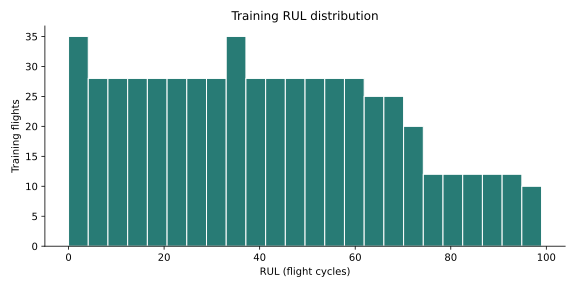
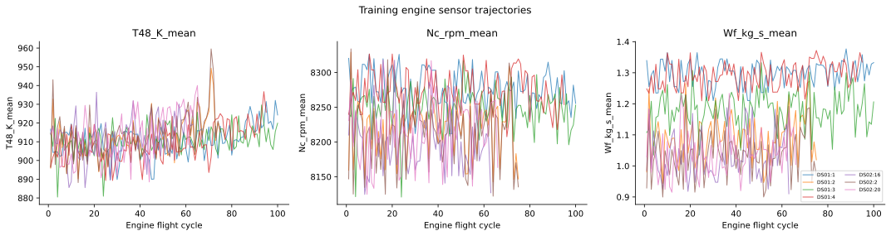
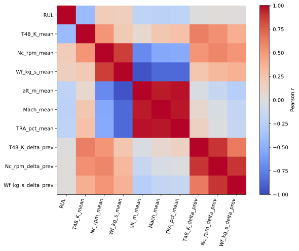
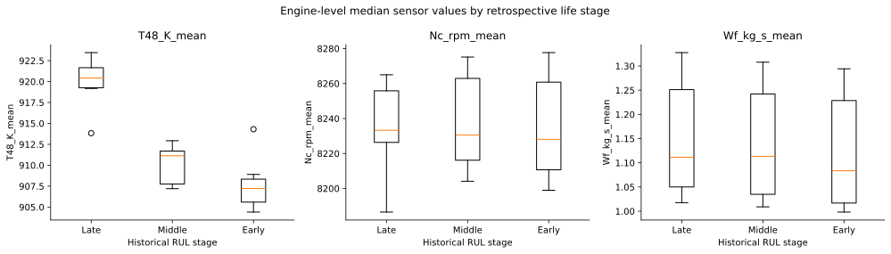
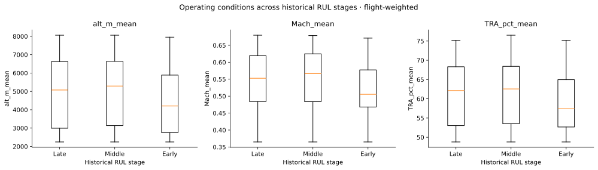
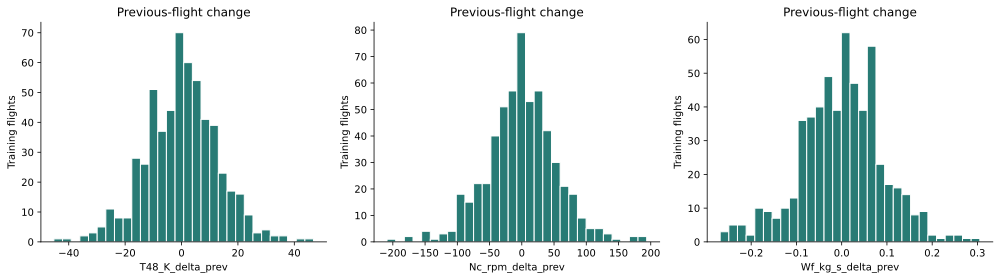

# Task 5 — Initial Descriptive Analysis

**GR05 · Industrial Analytics · HFU · WS 2026/27** 
**Evidence executed and reviewed:** 11 November 2026 
**Analysis foundation:** Denzel Gregory Pragassa; reproducibility/reporting completion AI-assisted, team review pending. 
**Research question:** How accurately can classical regression models estimate engine RUL from sensor/operating data compared with a simple baseline?

## Status and V6 deliverables

Task 5's descriptive computation/reporting artifacts have been completed for team presentation review. This does not complete model development or establish predictive accuracy. The supplied Project Tasks V6.0 PDF, p. 2, dated 9 November 2026 (internal header V12.0), asks for descriptive statistics, trends/patterns, hypothesis assessment, grouping and business insights, delivered as findings, report, dashboard, insight summary and storytelling slide.

| Deliverable | Evidence |
|---|---|
| Exploratory findings and descriptive statistics | Executed `notebooks/03-descriptive-analysis.ipynb`; CSVs under `reports/results/task5/` |
| Descriptive analytics report and key insights | This report and `training_insights.json` |
| Visual summary/dashboard | [analysis.html](../analysis.html); six analysis charts plus two reproducible structural charts |
| Grouping/segmentation | Retrospective RUL stages and engine-level median comparisons; no clustering claimed |
| Hypothesis assessment | H1–H4 below, explicitly descriptive rather than formal significance tests |
| Data storytelling slide | Story slide in the milestone draft under `presentations/milestone/` |

## Source lineage and reproducibility

Kaggle-acquired N-CMAPSS DS01/DS02 HDF5 → audited Task 3 `reports/results/cycles.csv` → reconstructed Task 5 means/history table. These are stages of one data lineage, not independent sources pooled as new evidence. Reconstruction does not restore raw high-frequency measurements or within-flight variance. The full Task 4 dataset remains a separate explicit input option, `SOURCE='full_task4'`, verified against its local artifact manifest.

Actual input for this execution: **Task 3 cycle aggregates; reconstructed means and causal history, not full Task 4 variances**. Path `reports/results/task5/flights_features_from_cycles.csv`; SHA-256 `a27eb575d1b7c4cd16dc665308af0970837954435094f11675bc3e863b5e1c99`. Task 3 cycle export SHA-256 `c1da1755ec17a3929039cefa61bc0547c612152b5b0c98323e9f141d38c8c472`. Task 4 split policy version `task4-v1-f8ab427897d5`. The source table has 1,542 rows, but analysis uses **574 training flights only**; the fixed validation table is displayed separately. Test/quarantine rows are not used to develop these sensor findings.

Rebuild input with `python scripts/build_task5_inputs.py`, execute the notebook top to bottom, then run `python scripts/build_task5_report.py`. The notebook also regenerates both structural charts from `engines.csv`. Its appendix includes historical test structure for context, not feature selection. The tracked reconstruction was independently compared with the overlapping full Task 4 fields within numerical tolerance.

## Findings and hypothesis assessment

### Training findings recorded before the validation output
- **H1 — sensor association:** T48–RUL Pearson r is negative in 7/7 training histories, ranging from -0.540 to -0.299. This is exploratory association, not proof of wear causality or validated prediction.
- **Retrospective grouping:** paired late-minus-early T48 engine medians are higher by a median 13.62 K across 7 histories (range 4.93–17.82 K). Groups use true RUL (0–20, 21–50, >50), so they cannot be deployed as known inputs.
- **H2 — historical changes:** each difference has 567 observed training values; the first flight in each history has no previous observation. Differences describe short-term changes; added predictive value is untested.
- **H3 — operating context:** altitude/Mach/throttle vary across flights and groups. Displayed medians document context; they do not establish a causal or adjusted effect. Whole-flight summaries mix phases.
- **H4 — heterogeneity:** Nc–RUL r ranges from -0.153 to 0.199, including both signs. T48 association also varies in magnitude. A universal sensor threshold is not justified.

**Business interpretation:** temperature context and recent history are candidates for later RUL modeling. Overestimating RUL could delay an intervention; underestimating could prompt premature maintenance. We have not demonstrated forecast accuracy, costs, savings, or operational suitability.

**Evidence scope:** 574 flights; 7 dataset-scoped histories but only 6 conservative unit-ID groups. No independent-observation significance tests. These data had already been examined during the integration review; this write-up is not a preregistered or blinded hypothesis test.

### H2 numerical detail

Previous-flight-difference correlations with RUL are T48_K_delta_prev: -0.006, Nc_rpm_delta_prev: 0.021, Wf_kg_s_delta_prev: 0.015. These small pooled linear associations do not establish an incremental prediction benefit; nonlinear or engine-specific effects are not ruled out. We retain history as a candidate to evaluate on development engines rather than claim it improves forecasting.

### H3 operating-condition summaries

| Historical stage | Median altitude [m] | Median Mach | Median throttle [%] |
| --- | --- | --- | --- |
| Late | 5075.2 | 0.553 | 62.13 |
| Middle | 5291.1 | 0.566 | 62.55 |
| Early | 4203.0 | 0.505 | 57.41 |

These are **flight-weighted** medians. They document different operating context across retrospective life stages; they are not an adjusted causal comparison and may reflect source/engine composition. Each stage contains a different set of flights from the same histories.

### Descriptive validation check

The four validation source histories have T48–RUL correlations from **-0.470 to -0.196**, all negative. Their magnitudes differ, and Wf includes a positive association in DS02:18. This is a fixed exploratory check of the branch's three preselected channels. Validation had already been inspected during integration review; this is not independent preregistered confirmation. No model selection or test evaluation is performed here.

| Validation history | Sensor | Pearson r |
| --- | --- | --- |
| DS01:5 | T48_K_mean | -0.470 |
| DS01:5 | Nc_rpm_mean | 0.159 |
| DS01:5 | Wf_kg_s_mean | -0.153 |
| DS01:6 | T48_K_mean | -0.196 |
| DS01:6 | Nc_rpm_mean | 0.368 |
| DS01:6 | Wf_kg_s_mean | -0.065 |
| DS02:18 | T48_K_mean | -0.325 |
| DS02:18 | Nc_rpm_mean | 0.155 |
| DS02:18 | Wf_kg_s_mean | 0.032 |
| DS02:5 | T48_K_mean | -0.422 |
| DS02:5 | Nc_rpm_mean | 0.127 |
| DS02:5 | Wf_kg_s_mean | -0.151 |

## Full summary statistics

| Variable | Count | Mean | Sample std | Minimum | Maximum |
| --- | --- | --- | --- | --- | --- |
| RUL | 574.0 | 41.834 | 25.891 | 0.000 | 99.000 |
| T48_K_mean | 574.0 | 911.541 | 10.343 | 880.481 | 959.553 |
| Nc_rpm_mean | 574.0 | 8239.921 | 46.925 | 8120.758 | 8333.998 |
| Wf_kg_s_mean | 574.0 | 1.156 | 0.128 | 0.900 | 1.377 |
| alt_m_mean | 574.0 | 4739.441 | 1784.466 | 2245.262 | 8060.019 |
| Mach_mean | 574.0 | 0.539 | 0.080 | 0.365 | 0.680 |
| TRA_pct_mean | 574.0 | 60.427 | 7.851 | 48.783 | 76.512 |

Histories are **not** independent flight samples. Seven source histories map to six conservative unit-ID groups. No standard errors or significance tests treating 574 flights as independent subjects are reported.

## Visual evidence

### Training RUL distribution

574 flights, 7 source histories, 6 conservative groups. RUL spans 0–99 cycles.

### Sensor trajectories

T48 in Kelvin, Nc in rpm, Wf in kg/s. Operating conditions and engine/source differences remain.

### Training correlations

Descriptive Pearson correlations; repeated flights are dependent. No p-values or causal claims.

### Retrospective RUL-stage comparison

One median per source history and stage; Late 0–20, Middle 21–50, Early >50. Groups use true RUL, never deployable inputs.

### Operating context

Flight-weighted distributions, not engine-median comparisons. Regime variation can confound sensor–RUL associations.

### Previous-flight differences

567 nonmissing values per channel; 7 expected first-flight gaps. Added predictive value is untested.

## Business story for the milestone

**Observation:** T48 is higher in the historical late-life group and negatively associated with RUL within each training source history.

**Interpretation:** temperature and operating context deserve investigation as model inputs. Core speed and fuel-flow relationships vary; a single universal threshold is not justified.

**Decision next:** compare a transparent constant baseline with simple regression models, using grouped development validation before final test. A training mean constant is natural for squared-error comparison; a median constant minimizes absolute error. Model scores and savings are still unknown.

**Practical limits:** overoptimistic RUL could defer maintenance, pessimistic RUL could encourage premature work. These are possible decision consequences, not measured costs. A real deployment would require independent validation and domain oversight beyond this semester project.

## Provenance updates and remaining caveats

The 2021 journal paper [Table 5](https://www.mdpi.com/2306-5729/6/1/5) confirms P2 as total pressure at the fan inlet, in psia (checked 11 November). The older local preprint omitted that row. Task 4 still excludes P2 to retain the selected 17-channel representation. Its current code/metadata refresh creates a new hash-identified version without changing the representation or 50-column matrix schema; earlier local versions remain intact.

The paper declares the dataset CC0 1.0. Current Kaggle metadata reports version 1 and the license label U.S. Government Works; see the inventory/source snapshot. The exact original local download-version match is still unproven. Real flight profiles drive simulated degradation and sensor responses. There is no evidence here of operational aviation suitability, real-engine fault prediction, economic savings, or RUL accuracy. Cross-subset independence remains uncertain; conservative grouping and unit-10 quarantine mitigate one known risk without proving all independence.

## Sources and review history

- Supplied Project Tasks V6.0, p. 2; milestone comments handout for presentation form.
- [Task 3 report](05-data-understanding.md), [Task 4 report](06-data-preparation.md), [data access](../data/README.md), and tracked CSV exports.
- Arias Chao et al. (2021), [Data 6(1), 5](https://doi.org/10.3390/data6010005); [Kaggle redistribution](https://www.kaggle.com/datasets/bishals098/nasa-cmapss-2-engine-degradation).
- Denzel's six-commit Task 5 branch was integrated on 11 November as a working draft. That review ran all eight original code cells in an isolated checkout. This subsequent milestone-readiness pass saves execution outputs, numerical interpretation, source options and regeneration steps in the repository.
- [AI assistance log](ai-use-log.md); human fact-checking and rehearsal pending.

This report/dashboard are generated by `scripts/build_task5_report.py` from notebook exports. The assessment is descriptive; no predictive model is fitted.
